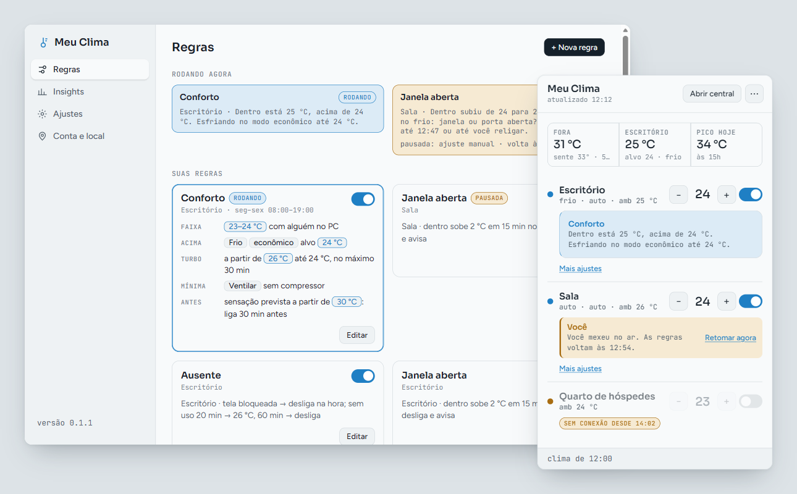

<div align="center">

# Meu Clima

**Seu ar-condicionado Electrolux no ritmo do seu dia, direto da bandeja do Windows.**

[](https://github.com/adrianocaldeira/meu-clima/releases)
[](https://dotnet.microsoft.com/)
[](#-instalação)
[](LICENSE)
[](https://github.com/adrianocaldeira/meu-clima/actions/workflows/ci.yml)
[](https://github.com/adrianocaldeira/meu-clima/releases)

[**⬇️ Baixar**](https://github.com/adrianocaldeira/meu-clima/releases/latest) ·
[**📖 Wiki**](https://github.com/adrianocaldeira/meu-clima/wiki) ·
[**🗺️ Roadmap**](#️-roadmap) ·
[**🐛 Reportar bug**](https://github.com/adrianocaldeira/meu-clima/issues/new/choose)

<br>



</div>

---

> [!IMPORTANT]
> **Antes de baixar, confira se serve para você:**
>
> - Funciona **apenas com ar-condicionado Electrolux com Wi-Fi**, já cadastrado no **app Electrolux**
>   do celular. Outras marcas, ou aparelhos Electrolux sem Wi-Fi, não funcionam.
> - Exige criar **uma API key e um refresh token** no portal de desenvolvedor da Electrolux
>   ([developer.electrolux.one](https://developer.electrolux.one/)). É gratuito e leva uns 5 minutos —
>   [passo a passo abaixo](#-credenciais-da-electrolux-passo-a-passo).
> - As regras automáticas só rodam **com o PC ligado e você logado no Windows**. PC desligado,
>   hibernado ou na tela de login = nenhuma regra executa (a exceção é o timer que o "Modo noite"
>   programa no próprio aparelho).
> - **Não é afiliado, patrocinado nem endossado pela Electrolux.** É um projeto independente que usa a
>   API pública oficial com as suas próprias credenciais.

## ✨ Por que existe

O app oficial controla o ar-condicionado, mas não sabe nada do seu dia: se você saiu da mesa, se
lá fora já está mais fresco, se a tarde vai esquentar daqui a uma hora.

**Meu Clima** fica na bandeja do Windows, junta o estado do aparelho com o clima de fora e aplica
regras simples que você liga e desliga. Sem conta nova, sem servidor intermediário: o app fala direto
com a API da Electrolux e com o Open-Meteo.

## 🚀 Funcionalidades

| | | |
|---|---|---|
| 🧊 **Controle rápido** pela bandeja: ligar, desligar, temperatura, modo, ventilação e timer, em todos os aparelhos da conta | 🌤️ **Clima externo** via [Open-Meteo](https://open-meteo.com/): agora e previsão | 🤖 **4 regras automáticas** que você liga, desliga e configura |
| 📊 **Insights**: horas ligado, energia e custo estimados (com projeção do mês), tempo para esfriar, gráfico fora × dentro | 🪟 **Inicia com o Windows** (você escolhe ao instalar) | 🔄 **Atualização automática** com verificação de integridade |
| 🇧🇷 **100% em português** · tema claro, escuro ou do sistema | 🔒 **Credenciais só no seu PC**, protegidas pelo Windows (DPAPI) | 📦 **Single-file `.exe`** self-contained |

### Regras automáticas

| Regra | Em uma frase |
|---|---|
| **Conforto** | Mantém dentro entre 23 e 24 °C: Frio econômico, só ventila na mínima, turbo só no calor forte. Liga antes do calor pela sensação térmica prevista. |
| **Ausente** | Tela bloqueada, PC suspenso ou desligando: desliga na hora (fora da pausa por ajuste manual). Sem uso: alivia aos 20 min, desliga aos 60. Na volta, as regras decidem. |
| **Janela aberta** | Ligado em Frio e o ambiente esquentando sem voltar: desliga, avisa e diz o motivo. |
| **Modo noite** | Timer de 4 h no próprio aparelho e +1 °C por hora. |

No painel da bandeja, cada aparelho mostra numa frase quem está no comando e por quê: você, uma regra
agindo, uma regra de olho ou em espera. Mexeu à mão (no app, no controle ou no celular)? As automações
daquele aparelho pausam por 60 min; "Retomar agora" encerra a pausa. O menu **⋯** do painel pausa todas
as regras por 1 h, verifica atualizações e encerra o app.
Detalhes e limites de cada uma na [Wiki → Regras](https://github.com/adrianocaldeira/meu-clima/wiki/Regras).

## 📥 Instalação

### Opção 1 — Instalador (recomendado)

Baixe `MeuClima-Setup-vX.Y.Z.exe` na [página de releases](https://github.com/adrianocaldeira/meu-clima/releases/latest) e execute. Não precisa de administrador. No fim, marque **"Executar Meu Clima"**. O instalador pergunta se o app deve iniciar com o Windows (vem marcado); mude depois em **Ajustes** ou no menu do ícone da bandeja.

### Opção 2 — Portable (sem instalar)

Baixe `MeuClima.exe` na mesma página e execute. Self-contained — não precisa de .NET na máquina. A versão portable **não se atualiza sozinha**: ela só abre a página da release nova.

### Opção 3 — Compilar do código

```powershell
# Requisitos: .NET 10 SDK
git clone https://github.com/adrianocaldeira/meu-clima.git
cd meu-clima
dotnet run --project src/MeuClima/MeuClima.csproj
```

> [!NOTE]
> Windows 10 (1809+) ou Windows 11, x64. O runtime **WebView2** já vem no Windows 11; no Windows 10
> mais antigo, [baixe aqui](https://developer.microsoft.com/microsoft-edge/webview2/) se necessário.

## 🔑 Credenciais da Electrolux (passo a passo)

O Meu Clima usa a API oficial com **as suas** credenciais. Ninguém além de você e da Electrolux as vê.

1. **Confirme o aparelho no app Electrolux** do celular: o ar-condicionado precisa estar cadastrado e
   aparecendo online.
2. Acesse **[developer.electrolux.one](https://developer.electrolux.one/)** e entre com **a mesma conta**
   do app Electrolux.
3. No painel do portal, **crie uma API key** e copie o valor.
4. Ainda no portal, **gere um token**. O portal mostra um *access token* e um **refresh token** —
   copie o **refresh token**.
5. Abra o Meu Clima (ícone na bandeja) e cole a **API key** e o **refresh token** na tela de configuração.
   O app lista os aparelhos da conta. Escolha a sua cidade e o aparelho do cômodo onde fica o PC.

> [!WARNING]
> - O refresh token **muda a cada renovação** e o Meu Clima guarda o novo automaticamente. Se você usar
>   o mesmo token em outro lugar (script, automação residencial), um pode invalidar o outro — gere um
>   token só para o Meu Clima.
> - Nunca cole API key ou token em issue, print ou chat. Vazou? Revogue no portal e gere outro.
> - Os nomes dos botões no portal podem mudar; o passo a passo com mais detalhes está na
>   [Wiki → Primeiros passos](https://github.com/adrianocaldeira/meu-clima/wiki/Primeiros-passos).

## 🎯 Uso rápido

1. **Clique no ícone da bandeja** para ver o estado do ar, o clima lá fora e o controle rápido.
2. **Clique direito** no ícone para abrir a central, as regras, ligar ou desligar o início com o Windows,
   verificar atualizações ou sair.
3. **Revise as regras.** Ao terminar a configuração, o app cria as regras já ligadas. Desligue as
   que não servem para a sua rotina e ajuste os valores das outras.
4. **Veja os insights** depois de alguns dias de uso.
5. **Deixe "Iniciar com o Windows" ligado** se quiser as regras sempre ativas quando você estiver no PC.

## 🧱 Stack técnica

- **[.NET 10](https://dotnet.microsoft.com/)** + **WPF** — app nativo Windows, ícone de bandeja
- **[WebView2](https://learn.microsoft.com/microsoft-edge/webview2/)** — interface em HTML dentro da janela
- **[Microsoft.Data.Sqlite](https://learn.microsoft.com/dotnet/standard/data/sqlite/)** — histórico local para os insights
- **DPAPI** do Windows — proteção das credenciais no seu perfil de usuário
- **[Electrolux Group API](https://developer.electrolux.one/)** — controle do aparelho
- **[Open-Meteo](https://open-meteo.com/)** — clima externo (dados CC BY 4.0)
- **[Inno Setup](https://jrsoftware.org/isinfo.php)** — instalador

Detalhes na [Wiki/Arquitetura](https://github.com/adrianocaldeira/meu-clima/wiki/Arquitetura).

## 🗺️ Roadmap

### ✅ Já entregue (v0.2.0)
- Controle do ar-condicionado Electrolux pela bandeja, para todos os aparelhos da conta
- Clima externo e previsão do dia via Open-Meteo
- 4 regras automáticas: Conforto, Ausente, Janela aberta e Modo noite; as da v0.1 migram sozinhas
- Cada regra ligada a um aparelho, com pausa de 1 hora após ajuste manual
- Painel da bandeja mostra quem está no comando de cada aparelho e por quê
- Agenda por dias e horário no Conforto; horário diário no Modo noite
- Insights de uso com projeção do custo no mês e gráfico fora × dentro de 24 h ou 7 dias
- Tema claro, escuro ou do sistema (segue o Windows)
- Início com o Windows
- Atualização automática com verificação de integridade

Sugestões? [Crie uma issue](https://github.com/adrianocaldeira/meu-clima/issues/new/choose).

## 🤝 Contribuindo

Bug, ideia ou PR é bem-vindo. Leia [CONTRIBUTING.md](CONTRIBUTING.md) pra setup local e padrão de commits, e [CODE_OF_CONDUCT.md](CODE_OF_CONDUCT.md).

## 🔒 Segurança

Reportar vulnerabilidade: ver [SECURITY.md](SECURITY.md).

## 🛡️ Privacidade

O Meu Clima não coleta dados de uso. Ele só fala com a Electrolux (sua conta), com o Open-Meteo
(coordenadas da cidade que você escolheu) e com o GitHub (procurar versão nova, desligável em
**Ajustes**). Telas e fontes vêm de dentro do app. Detalhes em [PRIVACIDADE.md](PRIVACIDADE.md).

## 🔏 Assinatura e integridade

Os executáveis ainda não têm assinatura digital, por isso o Windows SmartScreen pode avisar na
primeira execução (veja o [FAQ](docs/wiki/FAQ.md)).

Cada versão é compilada pelo GitHub Actions a partir deste repositório
([`release.yml`](.github/workflows/release.yml)), nunca numa máquina pessoal. A página da release
mostra o SHA-256 de cada arquivo; o atualizador do app confere esse valor antes de instalar.

## 📄 Licença

[MIT](LICENSE) © Adriano Caldeira

Electrolux é marca de seus respectivos titulares. Este projeto não é afiliado à Electrolux — ver [NOTICE.md](NOTICE.md).

## 🙏 Agradecimentos

Dados de clima: **Weather data by [Open-Meteo.com](https://open-meteo.com/)** ([CC BY 4.0](https://creativecommons.org/licenses/by/4.0/)).
Ombros de gigantes: [WebView2](https://learn.microsoft.com/microsoft-edge/webview2/), [Microsoft.Data.Sqlite](https://github.com/dotnet/efcore), [SQLite](https://sqlite.org/), [Inno Setup](https://jrsoftware.org/isinfo.php).
